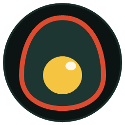

# 🥚 Tamago (玉子) — Japanese Zen Music Player

> **A distraction-free, open-source desktop music player for YouTube Music, SoundCloud, and offline local audio with a Zen Koi Pond interactive scrubber.**

<p align="center">
  
</p>

<p align="center">
  
  
  
  
</p>

> [!WARNING]
> ### 🛑 LOCAL STORAGE & PRIVACY NOTICE (DO NOT COMMIT LOCAL DOWNLOADS)
> All downloaded audio tracks, offline cached streams, thumbnails, and personalized playlists are stored locally in the `local-downloads/` directory.
> **This directory is strictly excluded from version control via `.gitignore`. Never remove this exclusion or push personal audio files, media caches, or private metadata to any public repository.**

---

## ✨ Features & Enhancements

- 🌊 **Interactive Zen Koi Pond Scrubber**:
  - Continuous Kohaku Koi fish smoothly swimming across the audio progress bar inside a water capsule.
  - Undulating veil tail, fluttering pectoral fins, and gentle breathing idle motion when paused.
- 🗂️ **Collapsible Modern Navigation Rail (Apple Music Style)**:
  - Multi-tier semantic layout: **DISCOVER**, **LIBRARY**, and **SYSTEM**.
  - One-click sidebar collapse/expand toggle ($74\text{px} \leftrightarrow 220\text{px}$).
  - Instant Zen Floating Micro-Tooltips ($0\text{ms}$ delay) in compact mode.
  - Standardized modern SVG glyphs.
- 💖 **Enhanced Playlist & Favorites Management**:
  - Dedicated **Favorite Playlists** grid with crimson heart badge.
  - **Smart Square Canvas Compression**: Auto center-crops and optimizes custom playlist covers down to high-quality $400 \times 400\text{px}$ images (~$30\text{KB}$).
  - **Dedicated Rename Playlist Modal**: Fast inline renaming with <kbd>Enter</kbd> to save and <kbd>Esc</kbd> to cancel.
- 🎨 **Unified Japanese Zen Aesthetic**:
  - Deep obsidian pond green (`#0b1413`), Oribe moss active containers (`#1e3833`), and vibrant Kohaku crimson accents (`#dc4b2f`).
- 🔒 **100% Privacy & Zero Telemetry**:
  - No user tracking, no sign-in requirements, and strictly local storage for playlists, history, and settings.

---

## 🚀 Quick Start & How to Run

### Prerequisites
- [Node.js](https://nodejs.org/) (version 18.x or 20.x recommended)
- `npm` (bundled with Node.js)

### 1. Clone the Repository
```bash
git clone https://github.com/limpbzkt5-cloud/Tamago.git
cd Tamago
```

### 2. Install Dependencies
```bash
npm install
```

### 3. Launch in Development Mode
```bash
npm start
```

### 4. Build Standalone Desktop Installer (Windows / macOS / Linux)
```bash
npm run dist
```
The installer binaries will be generated inside the `dist/` directory.

---

## 📁 Local Data Directory Structure
When Tamago runs, it manages local tracks in:
```text
local-downloads/
├── tracks/         # Offline cached .opus audio streams
├── thumbnails/     # Album artwork caches
├── lyrics/         # Synced lyrics files (.lrc)
└── metadata.json   # Track metadata index
```
*(All local files inside `local-downloads/` are strictly ignored by Git).*

---

## 🛠️ Audio Dependencies (Optional for Streaming/Downloading)
Tamago uses `yt-dlp` and `ffmpeg` for background stream resolving and audio extraction. You can place `yt-dlp.exe` and `ffmpeg.exe` in the `bin/` directory or have them available in your system `PATH`.

---

## 📜 License
Distributed under the **MIT License**.
